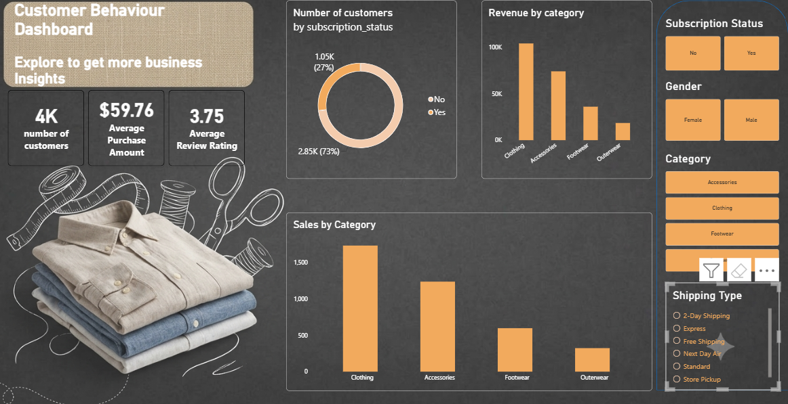

# 👕 Customer Behaviour Dashboard: Clothing Brand (Power BI)

An interactive Power BI dashboard that analyses customer behaviour for a clothing brand: who the customers are, what they buy, how much revenue each category brings in, and how subscription status relates to purchasing.



## Business Problem

A clothing brand wants to understand its customer base to decide where to focus marketing, stock and subscription efforts:

- Which product categories drive the most revenue and sales volume?
- How many customers are subscribers, and how large is the opportunity to convert the rest?
- How do spending and satisfaction vary by gender, category, subscription status and shipping type?

## Key Metrics

| Metric | Value |
|---|---|
| Number of Customers | ~3.9K |
| Average Purchase Amount | $59.76 |
| Average Review Rating | 3.75 |

## Dashboard Visuals

- **KPI cards:** Number of Customers, Average Purchase Amount and Average Review Rating.
- **Customers by Subscription Status (donut chart):** subscribers vs non-subscribers.
- **Revenue by Category (column chart):** total revenue for Clothing, Accessories, Footwear and Outerwear.
- **Sales by Category (column chart):** number of sales per category.
- **Slicers:** Subscription Status, Gender, Category and Shipping Type. Every visual updates together when a filter is applied.

## Key Insights

1. **Clothing and Accessories dominate.** Together they bring in roughly three quarters of total revenue, with Clothing alone close to 45%.
2. **Footwear and Outerwear are small contributors.** Footwear is around 15% of revenue and Outerwear under 10%, so they are the categories with the most room to grow.
3. **Category revenue follows sales volume.** The average spend per sale is similar across categories, so revenue differences come from how many items are sold, not from higher prices.
4. **Only 27% of customers are subscribers** (about 1.05K), while 73% (about 2.85K) are not. Converting even a small share of non-subscribers is a clear growth opportunity.
5. **Customer satisfaction is moderate.** The average review rating is 3.75, which leaves room to improve the experience.

> Figures are read from the dashboard and are approximate. Update them if your data changes.

## Tools and Skills Used

- Power BI Desktop
- Power Query for data cleaning and preparation
- DAX measures for the KPIs
- Slicers for interactive filtering, plus a custom background and layout at 1920 × 1080

## DAX Measures

```DAX
Number of Customers = DISTINCTCOUNT('clothing_brand_db customers'[customer_id])

Total Revenue = SUM('clothing_brand_db customers'[purchase_amount])

Average Purchase Amount = AVERAGE('clothing_brand_db customers'[purchase_amount])

Average Review Rating = AVERAGE('clothing_brand_db customers'[review_rating])
```

> Table and column names above are placeholders. Replace them with the ones in your model.

## Dataset

- **Source:** _add link here (for example Kaggle)_
- **Table:** `clothing_brand_db customers`
- **Key fields:** customer ID, gender, category, purchase amount, subscription status, shipping type, review rating
- **Cleaning steps:** _add the steps you did in Power Query_

## How to Open

1. Download `Clothing Brand Sales.pbix` from this repository.
2. Open it in Power BI Desktop (free, Windows only).
3. Use the slicers on the right to filter the report.

## Author

**Ajay Kumar Sabbani**
Data Analyst | Power BI | Sales & CRM Analytics
GitHub: [Ajaynetha1](https://github.com/Ajaynetha1)
